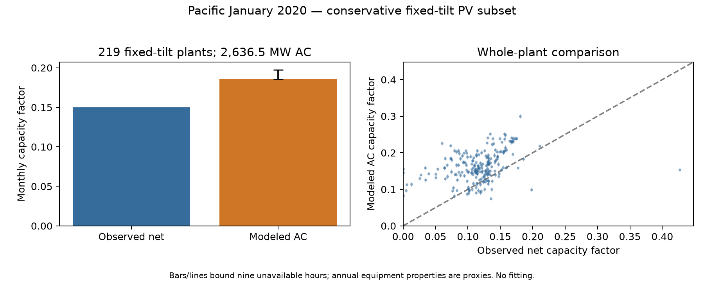

# November 24 PV comparison and archive preparation

## Whole-plant fixed-tilt PV comparison

Used the preserved December 2019 and January 2020 EIA-860M Operating sheets, the EIA-860 2020 solar workbook, the previously verified EIA-923 PV-only January extraction, and original January ERA5 weather. No raw workbook or weather archive is committed. Source byte hashes and output hashes are in [PV run metadata](../results/tables/fixed_tilt_pv_validation_metadata_2020_01.json).

The monthly PV inventories contain 797/804 generators at 573/579 plants and 11,584.4/11,754.3 MW respectively. Match entire PV unit sets, statuses, capacities, service dates and fuel/prime mover across the two snapshots. Require all units operating before January, valid consistent in-boundary coordinates, one numeric physical-plant EIA-923 SUN/PV observation, identical annual PV unit sets and annual AC capacities. Exclude synthetic state/fuel increments, missing energy, changed populations and whole plants with any failing unit. No partial capacity denominator is paired with whole-plant energy. The [plant audit](../results/tables/jan2020_pv_matching_audit.csv) retains exclusions.

**539 plants / 10,241.9 MW** meet the stable-capacity and observation conditions before equipment filtering. Of these, 320 have tracking, mixed or unclassified technologies. The narrower comparison retains **219 plants, 345 generators, 2,636.5 MW AC**, all reporting fixed tilt with valid orientation/DC capacity and no positively selected tracker, east–west, concentrator or other-solar flag. The EIA form is select-all: blank competing flags mean not selected, not independently proven absent. Annual geometry/equipment are year-end proxies; the screening cannot establish that equipment was unchanged throughout January.

EIA-860 2020 instructions explicitly define PV nameplate capacity as AC and separately request DC net capacity (Schedule 3, questions 1a/2b); orientation/technology questions are 29/30. Azimuth uses north 0°, east 90°, south 180°, west 270°. Angles may be representative within a reported generator. Use each reported DC/AC ratio and orientation; preserve the previously defined NOCT 45°C, −0.004/°C DC temperature coefficient, 14% other losses, 96% nominal inverter efficiency, Erbs/isotropic transposition and midpoint solar geometry. Use nearest-grid radiation/temperature with solar position at the reported plant coordinates. No parameters were fit to generation. The instructions are linked from the official [EIA-860 archive](https://www.eia.gov/electricity/data/eia860/).

| Matched-cohort quantity | Result |
| --- | ---: |
| Observed Pacific-January net generation | 294,147.955 MWh |
| Observed nominal monthly CF | 0.149956 |
| Known complete model hours | 735 of 744 |
| Modeled full-month CF bounds | 0.185284–0.197380 |
| Modeled full-month energy bounds | 363,444.231–387,172.731 MWh |

Even the lower model bound exceeds observed cohort energy by **23.56%**. All nine unavailable hours are bounded by CF 0–1, never imputed. This is evidence of overprediction for this selected fixed-tilt subset; it does not validate the tracker fleet or identify one cause. Loss assumptions, operational availability/curtailment, representativeness of annual parameters, irradiance/transposition and inventory reporting can contribute. Do not select a loss factor solely to force this month's mean to agree. The wind and PV discrepancies have opposite signs and must not be hidden by portfolio averaging.



The left panel shows aggregate nominal CF and the upper missing-hour bound; the right shows each plant with the same missing-hour bounds. [Plant bounds](../results/tables/fixed_tilt_pv_plant_bounds_2020_01.csv), [parameters](../results/tables/fixed_tilt_pv_model_parameters_2020_01.csv), [selected generators](../data/reference/jan2020_fixed_tilt_pv_generators.csv) and [hourly model](../data/processed/fixed_tilt_pv_hourly_2020_01.csv) are retained.

## Real adjoining-month, summer and held-out-weather rehearsal

Preselected five original-grid cells spanning California: (40.5, −121.5), (38.5, −121.5), (36.5, −120), (35.25, −118.5), (33.5, −116.5). Requested only **ERA5**, nearest grid selection, UTC, wind in m/s, and `elevation=nan` to disable downscaling from the public [Open-Meteo historical API](https://open-meteo.com/en/docs/historical-weather-api). Preserve URL/byte hash receipts and validate returned coordinates, units, every timestamp and finite values. Wind/temperature are instantaneous; radiation is the preceding-hour mean. Reconstructed wind components use the API's rounded speed/direction and radiation is converted to energy for the existing pipeline. These are secondary processed ERA5 data, not the original CDS components or independent wind observations.

There were **15 successful small API requests**, totaling about 0.6 MB of raw JSON (exact byte counts in metadata). The cache, receipts and NetCDF rehearsal files remain outside Git. At all five cells, January's 744 overlapping records were compared with the original supplied ERA5 files. The largest pointwise differences were **0.06918 m/s** wind speed, **0.07499°C** temperature and **0.49781 W/m²** GHI. Those differences are small here, but not zero; response rounding/processing and lack of an immutable upstream version prevent claiming source equivalence or splicing the two into one production archive.

| Preselected period | Complete modeled hours | Wind CF mean | PV CF mean | Monthly-file difference |
| --- | ---: | ---: | ---: | ---: |
| January–February 2020, including leap day | 1,440 | 0.042945 | 0.201121 | 0 |
| July 2020 | 744 | 0.038208 | 0.279109 | 0 |
| January 2021, unused weather year | 744 | 0.065012 | 0.169314 | 0 |

Each period includes its final boundary snapshot. The model uses the unchanged cubic wind curve and PV35 configuration, with cosine-latitude weights among these **five cells only**. Monthly NetCDF partitions, including an endpoint-only final file, reproduce continuous processing exactly. The hourly and 48-hour event catalogues also agree after canonicalizing microsecond/nanosecond timestamp precision. Offline replay verifies cached URL/byte hashes and makes zero weather downloads. [Summary](../results/tables/public_weather_rehearsal_summary.csv), [overlap differences](../results/tables/public_weather_overlap_2020_01.csv), [metadata/requests](../results/tables/public_weather_rehearsal_metadata.json) and separately labeled compact resources/catalogues are retained.

These means are **not statewide fleet estimates**. Neither July nor 2021 is matched to observed generation in this rehearsal. This closes a limited real-weather continuity test, not a full-grid or out-of-sample physical-validation gate. Do not infer seasonal error from these unvalidated means.

Attribution: weather reanalysis from ECMWF/Copernicus ERA5, processed and served by Open-Meteo; Open-Meteo data are supplied under [CC BY 4.0](https://open-meteo.com/en/licence). See the [provider's terms](https://open-meteo.com/en/terms). Derived series retain this attribution. EIA source data are U.S. federal statistical data; source and vintage are retained.

## Acquisition and temperature preparation

[Request plan](../results/tables/era5_2005_2024_request_plan.json): **242 unsubmitted monthly requests**, 240 core months plus December 2004/January 2025 context. Each has calendar-valid days, 0.25° grid, variables, bbox, expected shape/hours and a deterministic request hash. This file is a plan; no full-period retrieval or processing has started. Request-schema compatibility must be checked on the limited direct-CDS rehearsal before using it for production.

[Preflight helpers](../scripts/archive_preflight.py) reject changed grids, time gaps/duplicates, missing variables, unexpected accumulation semantics, rotated/unknown wind flags, missing or nonfinal `expver`, nonfinite values and broad implausible/sentinel values. The original January pair passes [recorded QC](../results/tables/archive_preflight_january_2020.json). The receipt checker accepts resumption only when request hash, byte hash, length and completion status match; tests reject missing/partial/tampered or differently requested files. A receipt is not scientific QC. The public weather rehearsal separately exercises verified offline cache reuse. **A full production download/checkpoint scheduler has not been executed or implemented here.**

[Study protocol](study_protocol.md) records the author's fixed-layout decision and its weather-attribution rationale, interval/core/event support, registered threshold sensitivities, temperature baseline and planned coincidence denominators. New [temperature helpers](../scripts/temperature_extremes.py) calculate complete UTC daily means and leave-one-year-out seasonal percentiles, with leap-day interpolation and censored sustained runs. They reject a pilot-length or incomplete-year climatology. No real full-period extreme thresholds, overlap statistics or uncertainty intervals are computed.

## Reproduction

Use Python 3.11.11 with `requirements-terrain.txt` installed and the preserved raw inputs outside Git. Substitute paths in the following commands; `--session-date` records the actual execution date. `scripts/01_download_era5.py` is the untouched original and is not needed.

```bash
python scripts/19_validate_fixed_tilt_pv.py --headless --session-date 2026-11-24 \
  --december /path/to/december_generator2019.xlsx --january /path/to/january_generator2020.xlsx \
  --annual /path/to/eia8602020.zip --instant /path/to/data_stream-oper_stepType-instant.nc \
  --accum /path/to/data_stream-oper_stepType-accum.nc
python scripts/20_rehearse_public_weather.py --session-date 2026-11-24 \
  --cache-dir /path/to/external/cache --original-instant /path/to/data_stream-oper_stepType-instant.nc \
  --original-accum /path/to/data_stream-oper_stepType-accum.nc
# Repeat the preceding command with --offline to verify the saved cache.
python scripts/21_prepare_archive_plan.py --session-date 2026-11-24 \
  --instant /path/to/data_stream-oper_stepType-instant.nc --accum /path/to/data_stream-oper_stepType-accum.nc
python scripts/22_verify_pre_expansion.py --cache-dir /path/to/external/cache \
  --eia923-archive /path/to/f923_2020.zip
python -m unittest discover -s tests -v
```

The verifier also needs the preserved source paths recorded by the PV run; regenerate that run metadata when moving the raw files. It directly checks raw monthly/annual EIA unit populations, AC denominators, reported technology and original EIA-923 energy. Handwritten equations reproduce all three five-cell wind/PV series within 2.23e-16 without importing the new matching/adapter/model helpers. These checks verify computation, not ERA5 accuracy or annual equipment timing.

The [verification record](pre_expansion_verification.json) gives check scope, byte hashes and remaining gates. The [GitHub workflow](../.github/workflows/scientific-checks.yml) runs syntax and unit checks on pushes to main and pull requests; it does not fetch weather, use CDS credentials or execute the original download script. The [corrected Ubuntu 24.04 run](https://github.com/Giulian14/California_Dunkelflaute/actions/runs/45485165337) passed installation, syntax and all **102 tests**. The initial latest-runner interpreter-availability failure and fix are recorded in the log. Previous scientific artifacts are preserved.
